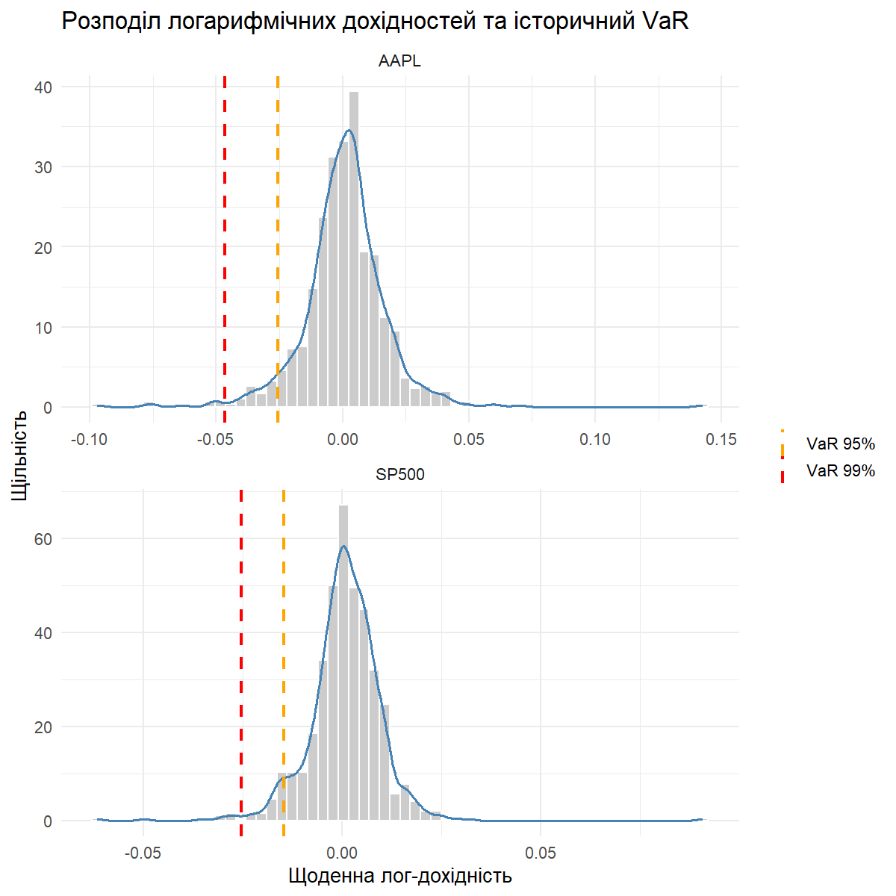

# risk-management-hw1

Практичне заняття №2: розрахунок Value at Risk (VaR) та Expected Shortfall (ES) в R.

## Структура проєкту

- `scripts/main_analysis.R` — R-скрипт аналізу
- `data/` — завантажені дані, результати та графік `var_chart.png`

## Дані та метод

- Активи: Apple (`AAPL`) та S&P 500 (`^GSPC`), Yahoo Finance, останні 3 роки, щоденні дані
- Дохідності: логарифмічні, пропущені значення видалено
- VaR (95% і 99%): історичний та параметричний (нормальний) методи
- ES (95%): історичний метод

## Результати (% від вартості; від'ємне значення = збиток)

<!-- Вставте сюди вміст data/results_table.md після запуску скрипта -->

| Актив | Hist VaR 95% | Hist VaR 99% | Param VaR 95% | Param VaR 99% | ES 95% |
|---|---|---|---|---|---|
| AAPL | -2.55% | -4.64% | -2.68% | -3.83% | -3.91% |
| SP500 | -1.47% | -2.54% | -1.47% | -2.11% | -2.14% |

## Висновок

Параметричний VaR припускає нормальність дохідностей і зазвичай недооцінює хвостовий ризик
порівняно з історичним (особливо на рівні 99%). ES показує середній збиток у найгірших 5% днів
і завжди перевищує VaR 95%.
